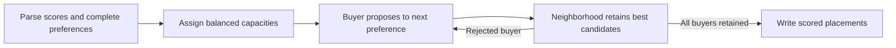

# Buyer placement optimizer

A standard-library Python matching exercise: assign buyers to their ranked neighborhoods while balancing occupancy. Neighborhoods rank buyers by compatibility, calculated as the dot product of their energy-efficiency, water and resilience scores.

The original [Pearl certification assessment context](https://github.com/dev-nezuko/buyer-placement-optimizer) and bundled fixture are retained. This is a synthetic allocation exercise, not a housing recommendation system.

## Run a worked example

```sh
python3 main.py
python3 main.py input.txt /tmp/placements.txt
python3 -m unittest discover -v
```

Use Python 3.11+. There are no third-party dependencies. Running the program writes placements; tests run separately.

A neighborhood line defines its three scores; a buyer line adds a complete preference order:

```text
N N0 E:7 W:7 R:10
N N1 E:2 W:1 R:1
H H0 E:3 W:9 R:2 N0>N1
H H1 E:4 W:3 R:7 N1>N0
```

For H0 and N0, compatibility is `3×7 + 9×7 + 2×10 = 104`. With one buyer per neighborhood, this example yields:

```text
N0: H0(104)
N1: H1(18)
```

The bundled 12-buyer fixture produces four buyers per neighborhood, matching [generated_output.txt](generated_output.txt). Scores are sorted descending within each output line.

## Matching rule

Buyers propose in preference order. Each neighborhood tentatively retains its highest-scoring buyers up to capacity and rejects the rest, who propose to their next preference. Equal compatibility scores favor the buyer appearing earlier in the input. This deterministic deferred-acceptance process replaces the former heuristic, which could assign one buyer twice while omitting another.

For `B` buyers and `N` neighborhoods, capacities are `B // N`, with the first `B % N` neighborhoods in input order receiving one extra place. This is an explicit balancing policy: counts differ by at most one, including when some neighborhoods receive no buyers. Every buyer must rank every neighborhood exactly once; identifiers must be unique. Invalid records fail rather than silently dropping buyers.



The resulting matching is stable for these fixed capacities and tie rules: a buyer cannot move to a preferred neighborhood that would prefer them to a retained buyer. It does not maximize the sum of compatibility scores or represent real-world fairness. The capacity allocation favors earlier neighborhoods when a remainder exists; a different policy would change results.

## Verification and scale

Five unittest methods pass. They regenerate the bundled output, reproduce the former duplicate-buyer bug, reject invalid input and check uniqueness, completeness, balanced occupancy and no strictly better blocking move across 16 synthetic buyer counts. Re-running matching also produces the same result.

Scoring and proposals each take up to `B × N` steps; each proposal currently sorts a neighborhood's retained candidates. All inputs, scores and assignments stay in memory. A heap per neighborhood would reduce repeated sorting for larger inputs. There is no database, UI, geographic data validation or production decision workflow.
